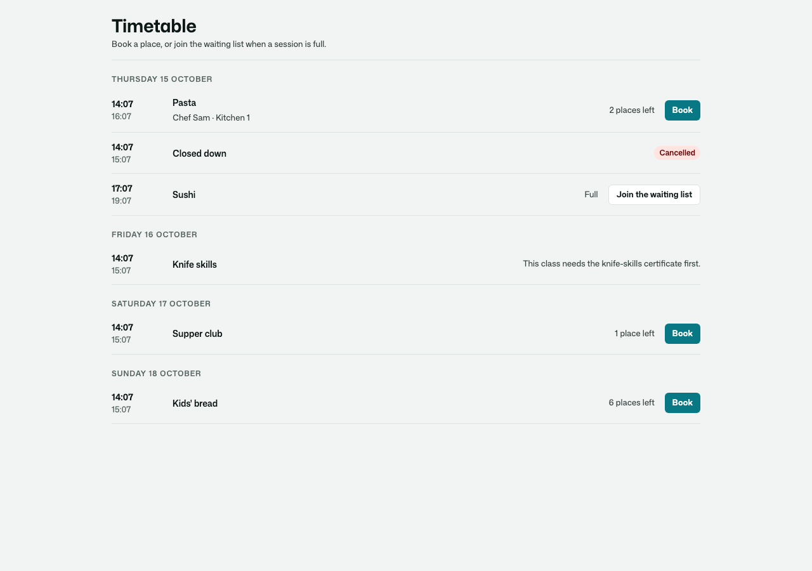
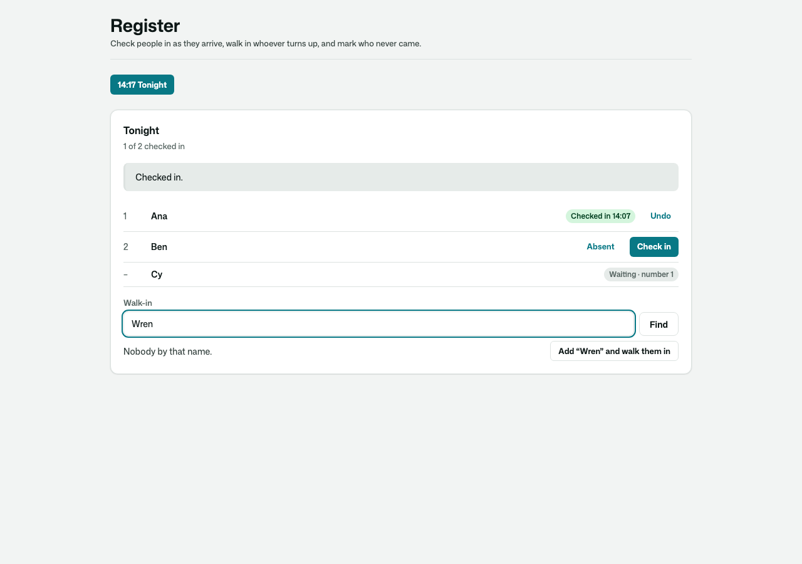
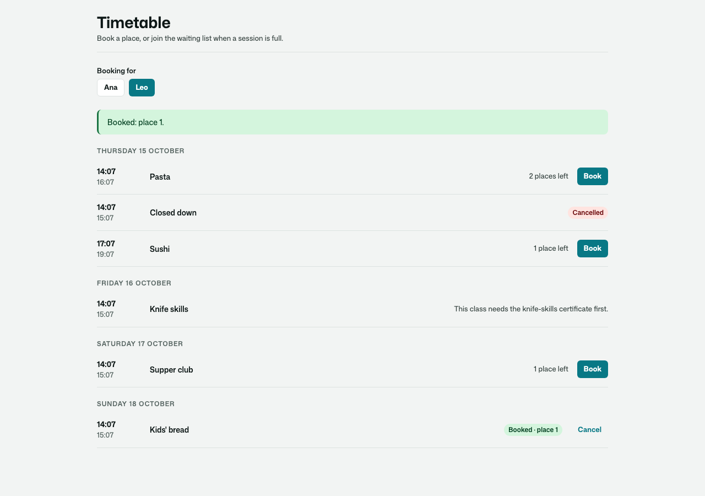
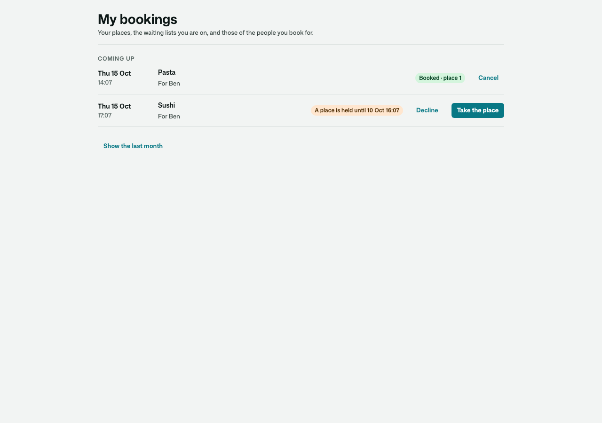
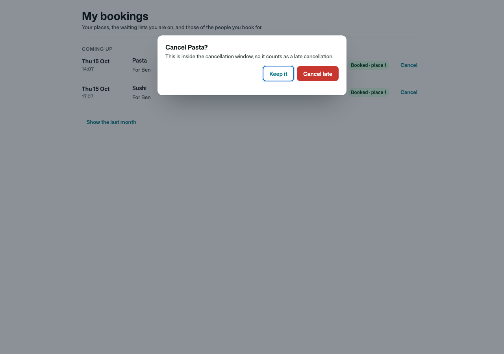
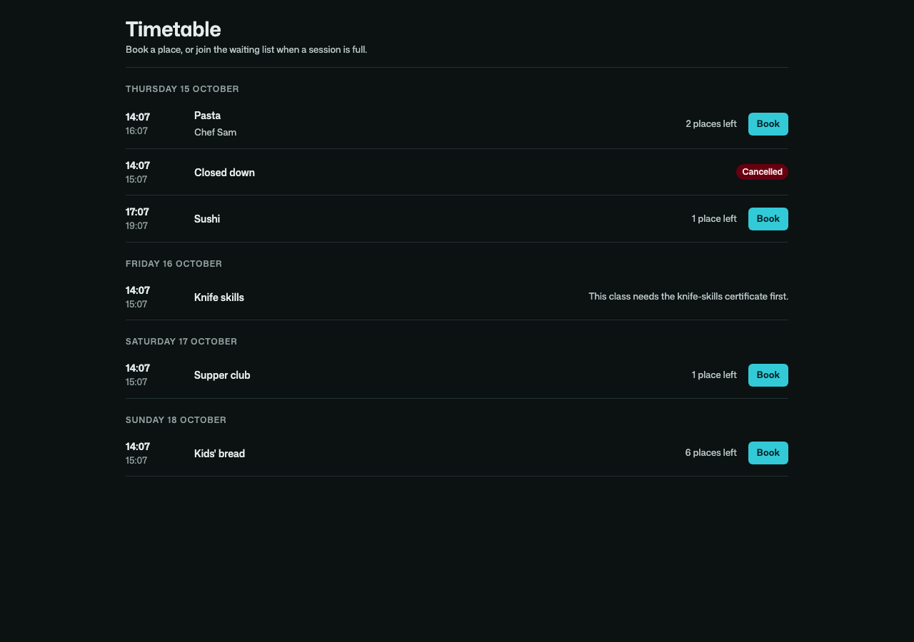

# Osysharp.ClassBookings

**Classes, courses and lessons that people book a place in** — never overbooked, with a waiting list, a register at the
door, and the rules a studio actually runs by.

For a fitness or yoga studio, a cookery school, a language school, a clinic's group sessions, a swimming pool's lessons,
a workshop programme — anything with a time, a fixed number of places and people who want one.

- **Numbered places that are never overbooked** — the data itself refuses a second holder of a place or a place beyond the
  capacity, however many people book at once.
- **A first-come waiting list** — a freed place is offered to the next in line and held for them for a limited time on a
  durable clock (or booked for them at once); an unanswered offer passes on. The app's own rules are asked again before a
  place reaches someone.
- **Booking windows, late cancellation and no-shows** — booking opens and closes when the app says; cancelling inside the
  window is recorded and heard as `LateCancellation`; the register closing marks who never came (`NoShow`). Money is the
  app's: charge a fee or take a credit with your own payments when you hear them.
- **The register** — check people in (or let them check themselves in near the start), walk someone in at the door
  (finding them, or making an account for them that they never sign in to), mark absence, and the register closes by itself
  after the session.
- **Instructors, rooms and equipment** — resources a session holds; no two sessions hold one at the same time, and a room
  takes no more people than it holds. Moving a session re-checks them and tells everyone booked.
- **Weekly series and courses** — every Tuesday at 18:00 in your own time zone (through daylight saving), planned ahead as
  your own kind of session; move or cancel one meeting; book a whole course; end it early.
- **Reminders** a day before (`SessionReminder`), and **booking for others** — a parent for a child, a carer for a client.

|  |  |
|---|---|
|  |  |
|  |  |

## Use it

```osy
// app.osy
use Osysharp.Identity@0;
use Osysharp.ClassBookings@0;
```

```osy
using Osysharp.Identity;
using Osysharp.ClassBookings;

policy ManagesSessions => IsDesk;                      // runs sessions, sees every booking
policy TakesAttendance => IsDesk;                      // a session's own instructor takes its register anyway

// Your own kind of session — the kit's rules hold for it.
entity YogaClass : BookableSession {
  [MaxLength(40)] string Level = "All levels";
  security { allow read when IsAuthenticated; allow create, update when ManagesSessions; }
}

app.ClassBookings = new ClassBookingsSetup {
  CancelFreeUntil = TimeSpan.FromHours(12), OfferWindow = TimeSpan.FromHours(2), RemindBefore = TimeSpan.FromHours(24),
};

// A rule of your own, found by the kit — nothing wires it.
class MembersOnlyForAdvanced : IBookingRule {
  public string? Refusal(BookableSession session, Principal person) { … return "The advanced class is for members."; }
}

[On] void ChargeLate(LateCancellation e) { /* take the fee with your payments kit */ }
[On] void Recount(PlacesChanged e) { /* a session got more or fewer places: e.Session, and e.From it had before */ }
```

Parents booking for children: add Osysharp.Guardianship and say
`policy BooksFor(Principal person) => person == user || ActsForDependant(person);`, and derive `SessionPeople` so the
timetable offers them (`BookableBy(me) => MeAndMyDependants()`). Walk-ins who never sign in: override
`SessionPeople.NewWalkIn(name)` with Osysharp.UserAccounts' `MakeManagedAccount`.

**Showing how full a class is to people who have not signed in** is the app's decision, and off until it says so:
give visitors the class itself with your own grant (`allow read when IsAuthenticated || IsAnonymous;` on your session
type), then `policy VisitorsSeePlacesLeft => true;`. A visitor then gets the same counts as anyone — `PlacesLeft`,
`WaitingCount`, the timetable — and never who holds a place. Without it a visitor who asks is refused, not told that
every place is free.

The pages are served at `/timetable`, `/my-bookings` and `/register`. Take one over by declaring a component of the same
name, or place `TimetableScreen()`, `MyBookingsScreen()`, `RegisterScreen()` on pages of your own. Every colour and size
comes from the theme, so a look re-skins them.

From code: `BookSession(session, person)`, `CancelBooking(b)`, `AcceptOffer(b)`, `DeclineOffer(b)`, `CheckIn(b)`,
`WalkIn(session, person)`, `MarkNoShow(b)`, `CloseRegister(session)`, `SetCapacity(session, n)`, `CancelSession(session)`,
`MoveSession(session, at)`, `AssignResource(session, resource)`, `PlanSeries(series, through)`, `BookSeries(series, person)`,
`EndSeries(series, from)`, `PlacesLeft`, `WaitingCount`, `QueuePosition`, `Timetable(from, days, person)`, `MyBookings()`.

## Personal data

An app that also uses Osysharp.Privacy gets **Osysharp.Privacy.ClassBookings** by itself: a person's bookings, attendance,
late cancellations and no-shows, counted, copied out and erased on request (a place they still hold passes on).

## What informed it

Mindbody's cancellation windows and late-cancel and no-show penalties, and its per-category fees, shaped
`CancelFreeUntil`, `LateCancellation` and `NoShow` as events the app charges on; Mindbody's notify-the-next-client waitlist
and Glofox's dynamic waitlist that promotes the next member shaped `WaitlistMode.Offer` / `Promote`; Glofox's booking
windows, recurring schedules, check-in by staff or at a kiosk and "add to waitlist or increase capacity" shaped the
windows, series, self check-in and `SetCapacity`; scheduling products that hold rooms and staff (no double-booked
instructor) shaped resources and clash checks.

## Source and tests

`model/` is the kit; `tests/` is a cookery school that uses it (with Osysharp.Guardianship for parents and
Osysharp.UserAccounts for walk-ins) — 63 tests as real people, six of them driving the pages.
`osy test` in `tests/`; `--pixels` for the screenshots above.

## Examples

Taken from this package's own tests, which compile and run on every release.

```osy
using Osysharp.Identity;
using Osysharp.UserAccounts;
using Osysharp.ClassBookings;

[Test(School)]
void places_are_given_lowest_first_and_the_next_person_waits_when_full() {
  runas (Ana) {
    var got = BookSession(Cls("Pasta"), Ana);
    Assert.Equal(BookingResult.Booked, got.Result);
    Assert.Equal(1, got.Booking!.Seat);
    Assert.Equal(1, PlacesLeft(Cls("Pasta")));
  }
  runas (Ben) { Assert.Equal(2, BookSession(Cls("Pasta"), Ben).Booking!.Seat); }
  runas (Cy) {
    var got = BookSession(Cls("Pasta"), Cy);
    Assert.Equal(BookingResult.Waitlisted, got.Result);
    Assert.Null(got.Booking!.Seat);
    Assert.Equal(1, QueuePosition(got.Booking!));
    Assert.Contains("waiting list", got.Message);
    Assert.Equal(0, PlacesLeft(Cls("Pasta")));
  }
  Assert.Equal(2, HeardCount("confirmed"));
  Assert.Equal(1, HeardCount("waitlist"));
}
```

From [`tests/booking.test.osy`](tests/booking.test.osy).

```osy
using Osysharp.Identity;
using Osysharp.UserAccounts;
using Osysharp.Guardianship;
using Osysharp.ClassBookings;

[Test(School)]
void a_parent_books_her_son_and_the_booking_records_who_booked() {
  runas (Ana) {
    var got = BookSession(Cls("Kids' bread"), Leo);
    Assert.Equal(BookingResult.Booked, got.Result);
    Assert.Equal(Ana.Id, got.Booking!.BookedBy!.Id);
    Assert.Equal(1, MyBookings().Count(l => l.Person == "Leo"));
  }
  runas (Ben) {
    var refused = BookSession(Cls("Kids' bread"), Leo);
    Assert.Equal(BookingResult.Refused, refused.Result);
    Assert.Contains("someone you act for", refused.Message);
  }
}
```

From [`tests/family.test.osy`](tests/family.test.osy).

```osy
using Osysharp.Identity;
using Osysharp.UserAccounts;
using Osysharp.Workflow;
using Osysharp.ClassBookings;

[Test(AtTheDoor)]
void the_desk_checks_people_in_and_the_school_hears_it() {
  runas (Omar) {
    var got = CheckIn(Mine("Tonight", Ana));
    Assert.Equal(BookingResult.CheckedIn, got.Result);
    Assert.Equal(BookingState.Attended, Mine("Tonight", Ana).State);
    Assert.NotNull(Mine("Tonight", Ana).CheckedInAt);
    Assert.Equal(BookingResult.NothingToDo, CheckIn(Mine("Tonight", Ana)).Result);
    UndoCheckIn(Mine("Tonight", Ana));
    Assert.Equal(BookingState.Booked, Mine("Tonight", Ana).State);
  }
  Assert.Equal(1, HeardCount("checked-in"));
}
```

From [`tests/register.test.osy`](tests/register.test.osy).

## Learn more

- [The Osysharp.ClassBookings reference](https://osysharp.com/reference/scheduling/class-bookings-kit/)
- [Osysharp.ClassBookings in the package catalogue](https://osysharp.com/packages/#osysharp-classbookings)
- [The Osy# reference](https://osysharp.com/reference/) — the language, the runtime and every kit
- [`llms-full.txt`](https://osysharp.com/llms-full.txt) — the whole reference and specification as one Markdown file, for a coding agent

## Licence

MIT — see [`LICENSE`](LICENSE).
